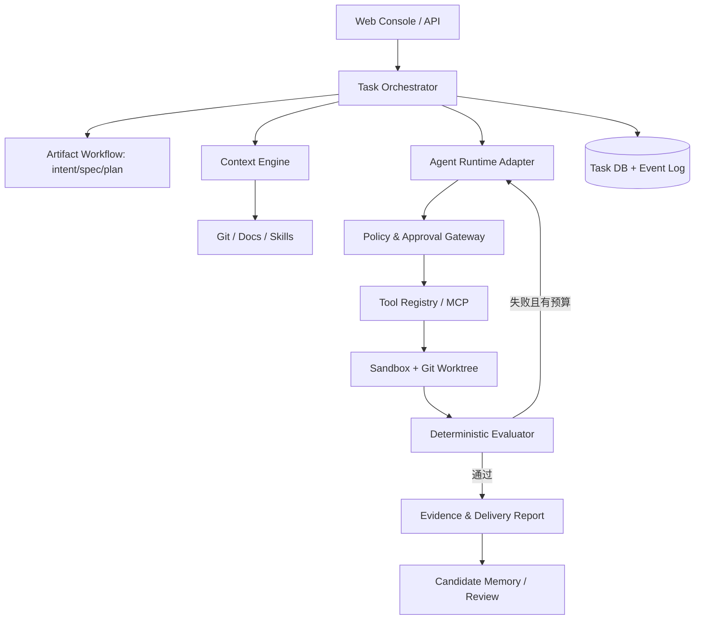

# Agentic DevOS · 技术架构设计 v1.0
状态：建议方案，尚未实施

## 1. 设计原则
Agent First、工具无关、复用成熟 Coding Harness、方法论资产不丢失、确定性验证优先、最小权限、先单 Agent 后多 Agent。

## 2. 逻辑架构


## 3. 推荐技术（待 ADR 确认）
- UI：Next.js + React + TypeScript。
- API：NestJS 或 Fastify；首版优先模块化单体。
- Worker：Node.js + TypeScript；MVP 单进程队列，后续 BullMQ/Redis。
- 数据：PostgreSQL（本地开发可 Docker Compose）。
- Agent：`CodingRuntime` 抽象 + 成熟 Coding Harness 适配；避免绑定特定模型。
- 执行：Docker 容器 + Git Worktree，限制 CPU、内存、网络、文件系统。
- 日志：结构化事件 + OpenTelemetry；敏感信息脱敏。
- 知识：先 Git 文件、规则、符号搜索；评测证明需要后再上 pgvector。

## 4. 目录规划
```text
ai-native-sdlc/
├── docs/                   # 保留既有方法论；新增 devos/ 设计文档
├── artifacts/              # 保留既有阶段模板
├── agents/                 # 保留 Skills/Hooks
├── evals/                  # 保留并扩展评测
├── infra/                  # 保留控制带；新增 compose
├── examples/               # 保留示例
├── apps/
│   ├── web/
│   ├── api/
│   └── worker/
├── packages/
│   ├── agent-core/
│   ├── context-engine/
│   ├── tool-kit/
│   ├── evaluator/
│   ├── memory/
│   ├── database/
│   └── shared/
└── pnpm-workspace.yaml
```

## 5. 模块职责
**Task Orchestrator**：状态机、预算、重试、审批、中断恢复。
**Artifact Workflow**：产物模板渲染、版本、审批关联。
**Context Engine**：项目目录、AGENTS/Skills、代码搜索、上下文来源。
**CodingRuntime Adapter**：统一执行入口、事件流、取消/恢复接口；不同 SDK 能力需单独适配。
**Tool Gateway**：工具白名单、路径规范化、参数校验、审批与审计。
**Evaluator**：命令退出码、测试报告、Diff 检查、需求验收证据。
**Memory**：任务轨迹、可复用经验候选、人工审核及过期处理。

## 6. 关键 ADR
- ADR-001：先单 Agent + 工具，避免过早多 Agent。
- ADR-002：保留 Markdown 产物链，平台数据库只管理索引与运行状态。
- ADR-003：计划批准前禁止代码写入。
- ADR-004：所有代码执行在独立隔离环境中进行。
- ADR-005：模型评估不得替代确定性测试；测试未运行要明确标注。
- ADR-006：知识写入采用候选/审核/发布生命周期。
- ADR-007：仓库写入仅在开发分支进行，PR 审核后合并。

## 7. 扩展接口
`ModelProvider`、`CodingRuntime`、`ContextProvider`、`ToolAdapter`、`Evaluator`、`MemoryStore`、`ApprovalProvider`。接口必须支持超时、取消、错误类型和审计事件。

## 8. 迁移原则
现有 `.github/workflows/agent-evals.yml` 使用自托管 runner 标签，实际可用性待验证；不要在未确认 runner 时宣称 CI 已运行。Hooks 脚本在平台接入后应作为真实强制策略执行，而非仅写入提示词。
